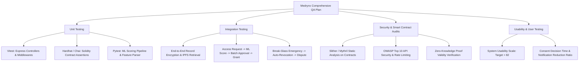

# Product Requirements Document (PRD)

## Project Title
**Scope-Bound Dynamic Consent and Anomaly-Aware Emergency Access Control for Blockchain-Based Electronic Health Record Systems**  
*(Project Codename: **Medrynx** / MediVault AI)*

---

### Document Control & Metadata

| Attribute | Specification |
| :--- | :--- |
| **Document Version** | 1.0.0 (Comprehensive Major Project Final Release) |
| **Project Type** | B.Tech Final Year Major Project (Capstone Design & Implementation) |
| **Academic Regulation**| R23 Regulation — VI / VIII Semester |
| **Department** | Department of Data Engineering |
| **Institution** | Maharaj Vijayaram Gajapathi Raj (MVGR) College of Engineering (Autonomous), Vizianagaram |
| **Project Team** | **Team of 4** — Lead: Karna (Roll No: `23331A4722`) & Project Associates |
| **Target Reviewers** | Department Project Review Committee (PRC), Academic Guides, External Examiners |
| **Last Updated** | September 2026 |
| **Document Status** | Approved for Implementation & Baseline Evaluation |

---

## 1. Executive Summary

Electronic Health Record (EHR) systems face a fundamental design tension in modern digital healthcare: balancing **patient-centric sovereign data autonomy** with **rapid, unhindered clinical accessibility during life-threatening medical emergencies**. 

Current blockchain-based EHR implementations suffer from five critical flaws:
1. **Coarse-Grained, Binary Consent**: Access is treated as an all-or-nothing switch over the patient's entire longitudinal medical history.
2. **Unaccountable "Break-Glass" Overrides**: Emergency mechanisms typically grant carte-blanche access to all historical records with minimal post-incident accountability.
3. **Absence of Pre-Approval Anomaly Warnings**: Unusual, suspicious, or out-of-specialty access requests are logged only *post-hoc*, never surfaced to the patient before approval.
4. **Consent Notification Fatigue**: Frequent, low-context consent prompts lead patients to habituated, rubber-stamp approvals, compromising real security.
5. **Immutability vs. Data Protection Rights**: Append-only blockchain architectures inherently clash with statutory deletion mandates (e.g., GDPR "Right to be Forgotten", HIPAA minimum necessary disclosure).

**Medrynx** solves these fundamental tensions by providing a unified, production-grade framework combining:
* **Scope-bound, smart contract-enforced dynamic consent** (scoped by Record Category, Duration, and Stated Clinical Purpose).
* **Tiered Break-Glass Emergency Access** graduated by verification strength with automated time-locked auto-revocation.
* **scikit-learn Anomaly Detection Engine** that scores clinician access requests against historical access patterns prior to patient authorization.
* **Intelligent Consent Batching** that aggregates low-risk routine requests from verified care teams to eliminate notification fatigue.
* **Mandatory Post-Emergency Reconciliation & Immutable Dispute Logging**.
* **Cryptographic Tombstone Record Architecture** reconciling GDPR data deletion with immutable on-chain auditing.
* **Zero-Knowledge Emergency Verification (Stretch Goal)** for privacy-preserving proof of emergency authority without premature data exposure.

---

## 2. Problem Statement & Research Questions

### 2.1 Problem Statement
Existing healthcare record systems and first-generation blockchain EHR architectures fail to offer contextual, fine-grained access control. When doctors request patient records, patients are forced to either expose their entire medical history or deny care. In critical emergencies, current "break-glass" protocols either delay care due to bureaucratic authorization or open wide attack surfaces where malicious actors or compromised clinician credentials harvest sensitive records without immediate detection. Furthermore, patients suffer from notification fatigue from constant access requests, and patients possess zero cryptographic recourse when their medical data is improperly accessed during claimed emergencies.

### 2.2 Research Questions

| ID | Research Question | Validation Target |
| :--- | :--- | :--- |
| **RQ-1** | Can access permissions be enforced at the smart-contract layer with fine granularity (record type, duration, purpose) without incurring prohibitive gas and latency overheads? | Contract execution overhead $\le 120,000$ gas per grant; end-to-end permission evaluation latency $< 80\text{ ms}$. |
| **RQ-2** | Can a lightweight machine learning anomaly-detection model, trained on synthetic access-pattern data, reliably flag out-of-pattern clinician requests as a meaningful pre-approval signal? | Classification Accuracy $\ge 92\%$, Inference Latency $< 30\text{ ms}$, Precision $\ge 0.90$, Recall $\ge 0.93$. |
| **RQ-3** | Does a tiered, verification-dependent break-glass model provide a superior security/availability trade-off compared to all-or-nothing emergency access? | Zero data exposure of non-critical records (imaging, genomic, psychiatric) during Tier-1 partial emergency requests. |
| **RQ-4** | Does a mandatory post-hoc reconciliation workflow measurably improve accountability and audit fidelity compared to passive audit logging? | $100\%$ of emergency access events surfaced to patient; immutable dispute anchoring with non-repudiation on-chain. |
| **RQ-5** | Does batching related low-risk consent requests reduce notification fatigue without compromising scrutiny on anomalous or high-risk requests? | Reduction of routine consent prompts by $\ge 65\%$ while isolating $100\%$ of high-risk / flagged requests for individual review. |

---

## 3. Product Vision, Goals & Success Metrics

### 3.1 Vision
To engineer a patient-governed, tamper-proof healthcare data exchange platform that empowers patients with complete sovereignty over their sensitive medical data while arming healthcare providers with fast, reliable, context-aware emergency access.

### 3.2 Engineering Objectives & Quantitative KPIs

```
+-----------------------------------------------------------------------------+
|                               MEDRYNX METRICS                               |
+------------------------------+------------------------------+---------------+
| Metric Category              | Target KPI                   | Measurement   |
+------------------------------+------------------------------+---------------+
| Smart Contract Gas Efficiency| < 120,000 gas / grant        | Ganache / EVM |
| Smart Contract Auth Latency  | < 100 ms verification time   | ethers.js RPC |
| ML Model Precision / Recall  | >= 90% Precision, >= 93% Rec | scikit-learn  |
| ML Scoring Inference Latency | < 30 ms per access request   | REST API test |
| Consent Prompt Reduction     | >= 65% decrease in alerts    | Batch engine  |
| Emergency Auto-Revoke Purity | 100% time-lock enforcement   | Cron & Block  |
| Storage Hash Integrity       | 100% SHA-256 match rate      | IPFS vs EVM   |
| System Usability Score (SUS) | SUS Score > 82 / 100         | User Testing  |
+------------------------------+------------------------------+---------------+
```

---

## 4. User Personas & Core Journeys

```mermaid
graph TD
    User([User Base]) --> Patient([Patient: Data Owner])
    User --> Doctor([Doctor: Clinician / Requester])
    User --> Admin([Hospital Admin: Compliance & Auditor])

    Patient --> P1[Upload Encrypted Medical Records]
    Patient --> P2[Grant / Revoke Scope-Bound Dynamic Consents]
    Patient --> P3[Review Anomaly-Scored Access Requests]
    Patient --> P4[Approve Low-Risk Batched Requests in 1-Click]
    Patient --> P5[Post-Emergency Reconciliation & Dispute Filing]

    Doctor --> D1[Search Patient Registry by Unique ID]
    Doctor --> D2[Submit Scoped Access Request with Stated Purpose]
    Doctor --> D3[View & Decrypt Permitted Records via AES-256]
    Doctor --> D4[Trigger Tiered Break-Glass Emergency Access]

    Admin --> A1[Verify Doctor Credentials & Medical Licenses]
    Admin --> A2[Monitor Real-time Anomaly Engine & Audit Logs]
    Admin --> A3[Investigate Contested Emergency Access Disputes]
    Admin --> A4[Audit Smart Contract & IPFS Anchoring Integrity]
```



### 4.1 Persona 1: Patient (Data Owner — Sovereign Controller)
* **Demographics**: Individuals seeking private, secure medical record management across multiple hospitals and clinics.
* **Pain Points**: Loss of control once records enter hospital silos; unawareness of who reads their sensitive data; notification fatigue from routine consent spam.
* **Core Jobs to be Done (JTBD)**:
  * Upload and categorize medical files (PDFs, DICOM, Lab Reports).
  * Enforce strict duration windows (e.g., "7 days only") and record boundaries (e.g., "Cardiology only").
  * Receive real-time AI anomaly alerts when a doctor requests data outside their typical practice.
  * Contest unjustified emergency break-glass sessions through immutable disputes.

### 4.2 Persona 2: Doctor / Clinician (Care Provider — Data Requester)
* **Demographics**: Hospital physicians, emergency doctors, surgeons, consulting specialists.
* **Pain Points**: Delay in accessing critical vitals during trauma; inability to access prior history from outside hospitals.
* **Core Jobs to be Done (JTBD)**:
  * Request temporary access specifying medical purpose (Diagnosis, Routine Follow-up, Second Opinion, Surgical Prep).
  * Rapidly trigger Break-Glass in trauma situations (Tier 1: Allergies, Meds, Blood Type in $< 3$ seconds; Tier 2: Full history).
  * Access decrypted records seamlessly in web viewer during active consent window.

### 4.3 Persona 3: Hospital Administrator / Compliance Auditor
* **Demographics**: Hospital IT directors, medical records compliance officers, forensic auditors.
* **Pain Points**: Difficulty in complying with HIPAA minimum-necessary disclosures and GDPR right-to-erasure audits.
* **Core Jobs to be Done (JTBD)**:
  * Verify doctor medical council registration and hospital affiliation.
  * Review platform-wide anomaly distribution and flagged access attempts.
  * Resolve patient-initiated emergency access disputes with cryptographic proof.

---

## 5. System Architecture & Technical Specifications

Medrynx utilizes a hybrid architecture that pairs the **tamper-proof integrity of Ethereum-compatible smart contracts** with the **scalability and privacy of off-chain encrypted IPFS storage** and **relational metadata indexing via PostgreSQL**.

```
+-----------------------------------------------------------------------------------+
|                                 MEDRYNX FRONTEND                                  |
|               (React 18 + TypeScript + Vite + TailwindCSS + Recharts)             |
+-------------------------+-------------------------------+-------------------------+
|     Patient Portal      |         Doctor Portal         |      Admin Portal       |
|  - Scope Consent UI     |   - Scoped Request Form       |  - Anomaly Analytics    |
|  - Batch Approval UI    |   - Tiered Break-Glass Modal  |  - Dispute Resolution   |
|  - Dispute & Reconcile  |   - Decrypted Record Viewer   |  - Audit Log Explorer   |
+-------------------------+-------------------------------+-------------------------+
                                       |
                                       | HTTPS / REST / JSON / Bearer JWT
                                       v
+-----------------------------------------------------------------------------------+
|                            API GATEWAY & BACKEND LAYER                            |
|                 (Node.js v22+ / Express 4 / TypeScript / Zod / Prisma)             |
+-----------------------------------------------------------------------------------+
| [Auth & RBAC]         [Zod Input Validation]        [Role Guard Middleware]       |
| [Record Crypto Mgr]   [Consent Batching Engine]     [Audit Event Dispatcher]      |
| [Auto-Revoke Cron]    [Tombstone State Manager]     [Dispute Workflow Handler]    |
+-----------------------------------------------------------------------------------+
         |                             |                               |
         | IPC / REST                  | Prisma ORM                    | JSON-RPC (ethers.js)
         v                             v                               v
+--------------------+   +---------------------------+   +--------------------------+
|  AI/ML MICROSERVICE|   |     METADATA DATABASE     |   |   BLOCKCHAIN LAYER       |
| (Python/FastAPI /  |   |   (PostgreSQL 16)         |   | (Solidity v0.8.20 /      |
|  scikit-learn)     |   |                           |   |  Ganache Local Testnet)  |
| - Isolation Forest |   | - Users (Doctor/Patient)  |   |                          |
| - Random Forest    |   | - Record Metadata & CIDs  |   | - MedrynxConsent.sol     |
| - Access Scorer    |   | - Access Requests & Scores|   | - MedrynxBreakGlass.sol  |
| - Feature Extractor|   | - Grants, Batches, Events |   | - MedrynxAudit.sol       |
| - Risk Explainers  |   | - Immutable Disputes      |   | - Gas-optimized Events   |
+--------------------+   +---------------------------+   +--------------------------+
                                       |
                                       | Encrypted Blob (AES-256-GCM)
                                       v
                         +---------------------------+
                         |    DECENTRALIZED STORAGE  |
                         |  (IPFS Nodes / Local IPFS)|
                         | - Encrypted CIDs          |
                         | - SHA-256 Anchored Root   |
                         +---------------------------+
```

### 5.1 Technology Stack Matrix

| Layer | Component | Technology | Rationale |
| :--- | :--- | :--- | :--- |
| **Client Frontend** | Single Page Application | React 18, TypeScript, Vite, TailwindCSS | High-performance, modular UI, type-safety, rapid state updates with custom hooks |
| **Data Visualization** | Audit & Analytics Charts | Recharts, Lucide React Icons | Interactive SVG charts for anomaly distribution and audit activity timelines |
| **Application Layer** | RESTful API Service | Node.js v22, Express 4, TypeScript | Asynchronous I/O, enterprise schema validation via Zod, strict type enforcement |
| **Data Modeling** | Relational ORM | PostgreSQL 16, Prisma ORM | ACID compliance, relational integrity across grants, batches, and disputes |
| **Decentralized Storage**| Encrypted File Store | IPFS (InterPlanetary File System) | Content-addressed storage for large medical imaging/PDFs without on-chain bloat |
| **Cryptography** | Payload Encryption & Hash | AES-256-GCM (Payload), SHA-256 (Anchoring) | Military-grade authenticated encryption + collision-resistant integrity verification |
| **Blockchain** | Smart Contract Engine | Solidity v0.8.24, Hardhat, Ganache, ethers.js v6 | Deterministic, immutable state machine for permissions, auto-expiry, and audit trails |
| **Machine Learning** | Anomaly Detection | Python 3.11, scikit-learn, NumPy, Pandas | Lightweight, fast execution (<30ms), high interpretability for clinical risk scoring |
| **Stretch Goal (ZKP)**| Emergency Credential ZK | Circom 2.1, SnarkJS, Groth16 | Zero-knowledge proof of valid emergency credential without revealing hospital context |

---

## 6. Detailed Functional Modules Specification

```
====================================================================================
                        MEDRYNX FUNCTIONAL MODULE TAXONOMY
====================================================================================
Module 1: Patient Sovereign Portal
Module 2: Doctor Clinical Portal
Module 3: Scope-Bound Dynamic Consent Engine
Module 4: Anomaly-Aware Access Scoring Engine
Module 5: Intelligent Consent Batching Engine
Module 6: Tiered Emergency ("Break-Glass") Access Control
Module 7: Mandatory Post-Emergency Reconciliation & Dispute System
Module 8: Cryptographic Storage & Blockchain Anchoring Layer
Module 9: Real-time Immutable Audit & Compliance Dashboard
Module 10: Zero-Knowledge Emergency Verification (Stretch Goal)
====================================================================================
```

---

### Module 1: Patient Sovereign Portal

#### 1.1 Objective
Empower patients with full sovereignty to manage records, issue custom consents, review ML risk evaluations, manage batch queues, and monitor live audit logs.

#### 1.2 Core Capabilities
* **Identity & Health Profile**: Secure registration with demographic data, blood group, emergency contacts, and unique Patient ID (e.g., `PT-98234`).
* **Client-Side Record Upload & Classification**: Upload medical files (PDF, PNG, JPG, DICOM), tag category (Cardiology, Laboratory, Imaging, etc.), preview metadata, and initiate client/server-side AES-256 encryption.
* **Consent Control Center**: View active, pending, expired, and revoked access grants. Instant 1-click on-chain revocation capability.
* **Incoming Request Reviewer**: Review doctor requests annotated with real-time ML Anomaly Score (0–100), risk tier badge (Low, Moderate, High), and feature explainers.
* **Notification Center**: Real-time notifications for incoming requests, emergency triggers, and expiration reminders.

#### 1.3 User Acceptance Scenarios (Gherkin Format)
```gherkin
Scenario: Patient uploads and encrypts medical record
  Given an authenticated patient on the Medical Records page
  When the patient uploads "Cardiology_Stress_Test.pdf" categorized as "Cardiology"
  Then the system computes SHA-256 hash of the AES-256 encrypted payload
  And uploads the ciphertext to IPFS generating an IPFS CID
  And stores the record metadata in PostgreSQL
  And anchors the record hash and ownership on the blockchain.

Scenario: Patient revokes an active doctor grant
  Given an active consent grant for "Dr. Ananya Sharma" for "Laboratory" records
  When the patient clicks "Revoke Consent"
  Then an on-chain transaction calls "revokeConsent(grantId)"
  And updates the local grant status to "REVOKED"
  And emits an immutable AuditLog event.
```

---

### Module 2: Doctor Clinical Portal

#### 2.1 Objective
Provide licensed healthcare practitioners with an efficient interface to locate patients, request contextual access, inspect authorized records, and trigger emergency overrides.

#### 2.2 Core Capabilities
* **Clinician Verification Status**: Display verified medical license ID (e.g., `MCI-2019-94821`), hospital affiliation, and medical specialty.
* **Patient Lookup**: Search patient registry by unique Patient ID or email.
* **Scoped Access Request Creator**:
  * Mandatory dropdown selection of **Record Category** (e.g., `Cardiology`, `Laboratory`).
  * Mandatory selection of **Clinical Purpose** (`Diagnosis`, `Routine_Follow_up`, `Second_Opinion`, `Surgical_Prep`, `Emergency_Treatment`, `Prescription_Renewal`).
  * Explicit **Duration Window** (e.g., 24 hours, 7 days, 14 days).
* **Authorized Records Viewer**: Clean document viewer streaming decrypted payloads directly to the browser memory without caching unprotected data to disk.
* **Break-Glass Emergency Request Trigger**: Dedicated modal with dual-tier emergency activation controls.

---

### Module 3: Scope-Bound Dynamic Consent Engine

#### 3.1 Objective
Eliminate coarse binary access control by enforcing strict, multidimensional boundaries directly in Solidity smart contracts.

#### 3.2 Dynamic Dimension Binding
Every consent grant $G$ is formally bound as a tuple:
$$G = \langle P_{id}, D_{id}, C_{rec}, \tau_{start}, \tau_{expiry}, \Phi_{purpose}, \sigma_{status} \rangle$$
Where:
* $P_{id}$: Patient Ethereum address / unique identity hash.
* $D_{id}$: Doctor Ethereum address / unique identity hash.
* $C_{rec} \in \{\text{Laboratory}, \text{Medication}, \text{Imaging}, \text{Clinical}, \text{Vaccination}, \text{Genomic}, \text{Cardiology}\}$
* $\tau_{start}, \tau_{expiry}$: Unix timestamps defining the active temporal window.
* $\Phi_{purpose}$: Formal medical rationale.
* $\sigma_{status} \in \{\text{ACTIVE}, \text{EXPIRED}, \text{REVOKED}\}$

#### 3.3 Smart Contract Enforcement Rule
If a doctor with an active grant for `Laboratory` attempts to decrypt an `Imaging` or `Genomic` record, or attempts access at timestamp $t > \tau_{expiry}$, the smart contract transaction will revert:
```solidity
error ConsentScopeExceeded(string requestedCategory, string grantedCategory);
error ConsentExpired(uint256 currentTime, uint256 expiryTimestamp);
```

---

### Module 4: Anomaly-Aware Access Scoring Engine

#### 4.1 Objective
Provide patients with actionable, pre-approval intelligence by scoring clinician requests using a machine learning model trained on clinician access patterns.

#### 4.2 Feature Engineering Matrix

| Feature Name | Type | Description | Weight in Risk Scoring |
| :--- | :--- | :--- | :--- |
| `specialty_match` | Binary ($0/1$) | Does the requested record match clinician specialty? (e.g., Dermatologist requesting Oncology records $= 0$) | High ($\approx 35\%$) |
| `prior_access_frequency`| Float | Rolling count of requests between this doctor-patient pair over 30 days | Moderate ($\approx 20\%$) |
| `request_purpose_alignment`| Categorical | Compatibility matrix between diagnosis code and record category | Moderate ($\approx 20\%$) |
| `hospital_affiliation_match`| Binary ($0/1$) | Is the clinician affiliated with patient's registered hospital network? | Moderate ($\approx 15\%$) |
| `time_of_request` | Float ($0-24$) | Deviation from clinician standard operating hours (e.g., 3:00 AM requests) | Low ($\approx 10\%$) |

#### 4.3 Risk Classification Tiers & Actions

```
[Access Request Submitted]
           |
           v
[ML Scoring Pipeline] ----> Generates Anomaly Score S in [0, 100]
           |
    +------+-----------------------------+
    |                                    |
    v                                    v
[Score S < 40: LOW RISK]       [Score 40 <= S < 70: MODERATE]     [Score S >= 70: HIGH RISK]
    |                                    |                                    |
    v                                    v                                    v
- Marked as Clean               - Amber warning badge on UI          - Urgent RED alert modal
- Eligible for Batching         - Shows feature breakdown            - Blocked from Auto-Batching
- Standard notification         - Requires explicit approval         - Requires explicit multi-factor review
```

---

### Module 5: Intelligent Consent Batching Engine

#### 5.1 Objective
Prevent patient notification fatigue and cognitive overload by safely aggregating routine, low-risk requests into a single grouped consent decision.

#### 5.2 Batch Qualification Logic
An access request $R_i$ is eligible for inclusion in a `ConsentBatch` $B$ if and only if:
1. $\text{AnomalyScore}(R_i) < 40$ (Strictly Low Risk).
2. $R_i.\text{isFlagged} == \text{false}$.
3. Doctor belongs to a declared multidisciplinary Care Team (e.g., General Physician + Consulting Lab Pathologist for the same hospital episode).
4. Temporal window overlap: $\Delta t \le 48\text{ hours}$.

#### 5.3 Batch Management Flow
```
Individual Low-Risk Requests:
[Dr. Priya (General Clinic) -> Laboratory]  ---\
[Dr. Rajesh (Radiology)    -> Imaging]      ----> Aggregated into [Batch #BT-401]
[Dr. Ananya (Pharmacy)     -> Medication]   ---/
                                                       |
                                                       v
                                          Single Patient Action:
                                   [Approve Batch (3 Requests)] or [Decline Batch]
```
If approved, three distinct scope-bound grants are minted on-chain in a single batched smart contract call, saving patient time and transaction gas fees.

---

### Module 6: Tiered Emergency ("Break-Glass") Access Control

#### 6.1 Objective
Provide immediate, life-saving clinical access during critical emergencies while strictly enforcing graduated minimum-necessary exposure and automated time-locks.

#### 6.2 Tiered Access Matrix

```
+-----------------------------------------------------------------------------------------+
|                                TIERED BREAK-GLASS SYSTEM                                |
+-----------------------+----------------------------------+------------------------------+
| Parameter             | Tier 1: Partial Emergency Access | Tier 2: Full Emergency Access|
+-----------------------+----------------------------------+------------------------------+
| Trigger Requirement   | Verified Hospital Identity Only  | Hospital ID + Declared Code  |
| Emergency Code        | Not required                     | Mandatory (e.g. EMG-CODE-RED)|
| Data Categories       | Critical Vitals Only:            | Complete Patient Medical     |
| Exposed               | - Blood Group & Rh Factor        | History (Excluding restricted|
|                       | - Severe Allergies & Reactions   | psychiatric/genomic unless   |
|                       | - Active Medications & Implants  | explicitly unlocked)         |
| Auto-Revoke Timer     | Strictly 15 Minutes              | Strictly 30 Minutes          |
| Immediate Alert       | SMS/Email + On-Chain Log         | Real-Time Broadcast + Audit  |
| Post-Hoc Mandate      | Mandatory Reconciliation         | Mandatory Audit & Dispute    |
+-----------------------+----------------------------------+------------------------------+
```

#### 6.3 Auto-Revocation Mechanism
1. Upon emergency invocation, smart contract stores `autoRevokeTimestamp = block.timestamp + durationMinutes * 60`.
2. Backend runs an active cron daemon (every 30 seconds) verifying active emergency sessions against block timestamps.
3. Once `block.timestamp >= autoRevokeTimestamp`, the smart contract modifier blocks any further decryption token generation.
4. An immutable `EmergencyExpired` event is written to the audit log.

---

### Module 7: Mandatory Post-Emergency Reconciliation & Dispute System

#### 7.1 Objective
Ensure full post-incident accountability by forcing all break-glass sessions to undergo formal patient review, with an immutable dispute mechanism.

#### 7.2 Dispute Resolution Lifecycle

```
[Emergency Access Concluded]
           |
           v
[Status: RECONCILIATION PENDING]
           |
           v
[Patient Reviews Event in Audit Dashboard]
(Displays: Doctor ID, Hospital, Timestamp, Records Accessed, Stated Reason)
           |
           +---------------------------------------------+
           |                                             |
           v                                             v
   [Patient Acknowledges]                       [Patient Contests Access]
           |                                             |
           v                                             v
[Status: ACKNOWLEDGED]                          [Status: DISPUTED]
(Recorded on Blockchain)                                 |
                                                [Patient Selects Reason]:
                                                - Unauthorized access
                                                - Incorrect emergency claim
                                                - Incorrect record accessed
                                                - Unexpected access duration
                                                         |
                                                         v
                                                [Dispute Logged On-Chain]
                                                - Immutable Tx Hash
                                                - Forwarded to Hospital Ethics
                                                - Status: UNDER_INVESTIGATION
                                                - Final Resolution Documented
```

---

### Module 8: Cryptographic Storage & Blockchain Anchoring Layer

#### 8.1 Objective
Ensure end-to-end data confidentiality, tamper resistance, and high-performance querying without storing high-volume Protected Health Information (PHI) directly on the blockchain.

#### 8.2 Cryptographic Pipeline
```
[Original Medical File] (e.g., MRI Scan, 15 MB)
           |
           v
[AES-256-GCM Encryption] with unique Record Key K_rec
           |
           +---> [Encrypted Blob (Ciphertext + 128-bit Auth Tag + IV)]
           |               |
           |               v
           |     [Upload to IPFS Node]
           |               |
           |               v
           |     [Returns IPFS CID (e.g., QmYwAP...)]
           |
           +---> [Compute SHA-256 Checksum of Encrypted Payload]
                           |
                           v
        [Anchor on Ethereum / Ganache Smart Contract]
        - recordId
        - patientAddress
        - ipfsCID
        - sha256Hash
        - timestamp
```

#### 8.3 Resolving Blockchain Immutability vs. GDPR Right to Erasure (The Tombstone Architecture)
Under GDPR Article 17, patients have the right to request deletion of personal health records. However, blockchain blocks are cryptographically immutable. Medrynx resolves this paradox:
1. **The Medical Content**: Stored exclusively off-chain in encrypted IPFS nodes.
2. **Crypto-Shredding**: Upon a valid patient deletion request, the record's encryption key $K_{rec}$ is permanently destroyed from the secure key store.
3. **IPFS Unpinning**: The encrypted blob is unpinned and garbage-collected from the IPFS cluster.
4. **On-Chain Tombstoning**: The smart contract marks the record as `TOMBSTONED`:
   * The original SHA-256 hash remains in historical blocks to prove that *a record once existed and was legally removed*.
   * Any read attempt against a tombstoned record throws a contract revert: `RecordTombstoned()`.
   * Complete audit integrity is preserved without retaining a single byte of decryptable personal data.

---

### Module 9: Real-time Immutable Audit & Compliance Dashboard

#### 9.1 Objective
Provide transparent, filterable, sub-millisecond visibility into all normal, emergency, revocation, and dispute transactions.

#### 9.2 Dashboard Architecture
* **Dual-Store Synchronization**: While all critical state changes generate on-chain events (`LogAccessGranted`, `LogEmergencyDeclared`, `LogDisputeFiled`), an automated backend listener indexes these events into the PostgreSQL `audit_log` table.
* **Audit Dashboard UI Components**:
  * **Interactive Metric Cards**: Total Requests, Active Grants, Emergency Incidents, Contested Disputes.
  * **Visual Trends (Recharts)**: Access attempts over time, normal vs. emergency ratios, ML anomaly score distribution.
  * **Search & Filter Matrix**: Filter by Patient ID, Doctor ID, Access Type (`NORMAL`, `EMERGENCY`, `REVOCATION`, `DISPUTE`), or Date Range.
  * **Cryptographic Verification Modal**: View and verify the Ganache on-chain transaction hash ($T_x$) and block confirmation height.

---

### Module 10: Zero-Knowledge Emergency Verification (Stretch Goal)

#### 10.1 Objective
Enable a requesting hospital or emergency responder to prove to the smart contract that they possess a valid, accredited emergency dispatch authorization **without revealing sensitive institutional or dispatch identifiers** prior to access logging.

#### 10.2 zk-SNARK Protocol Architecture
```
[Private Inputs]:
- Hospital Emergency Private Key: sk_hosp
- Emergency Dispatch Credential Token: cred_dispatch
- Emergency Level Bitmask: lvl

[Public Inputs]:
- Hospital Accreditation Merkle Root: Root_registry
- Emergency Timestamp Hash: H(t_now)
- Patient Anonymized Address: Addr_anon

                      +-----------------------------+
                      | Circom zk-SNARK Circuit     |
                      | "EmergencyCredentialVerifier"|
                      +-----------------------------+
                                     |
                                     v
                  Generates zk-Proof pi = (A, B, C)
                                     |
                                     v
                  [Ethereum Smart Contract Verifier]
                  - verifier.verifyProof(A, B, C, publicInputs)
                  - Returns TRUE: Instantly unlocks Tier-1 Emergency
                  - Returns FALSE: Transaction Reverts
```

---

## 7. Database Schema & Data Models (PostgreSQL & Prisma)

The relational schema maps domain models across all 10 modules:

```prisma
// datasource and generator configurations
generator client {
  provider = "prisma-client-js"
}

datasource db {
  provider = "postgresql"
  url      = env("DATABASE_URL")
}

// Role and Status Enums
enum UserRole {
  PATIENT
  DOCTOR
  ADMIN
}

enum DoctorVerificationStatus {
  VERIFIED
  PENDING
  REJECTED
  SUSPENDED
}

enum RecordCategory {
  Laboratory
  Medication
  Imaging
  Clinical
  Vaccination
  Genomic
  Cardiology
}

enum RecordFileType {
  PDF
  JPG
  PNG
  DICOM
  JSON
}

enum StorageStatus {
  ENCRYPTED_AND_ANCHORED
  PENDING
  ARCHIVED
  TOMBSTONED
}

enum RequestPurpose {
  Diagnosis
  Routine_Follow_up
  Second_Opinion
  Surgical_Prep
  Emergency_Treatment
  Prescription_Renewal
}

enum RiskLevel {
  LOW
  MODERATE
  HIGH
}

enum RequestStatus {
  PENDING
  APPROVED
  REJECTED
  EXPIRED
  REVOKED
}

enum ConsentStatus {
  ACTIVE
  EXPIRED
  REVOKED
}

enum BatchStatus {
  PENDING
  APPROVED
  REJECTED
}

enum EmergencyAccessLevel {
  PARTIAL
  FULL
}

enum ReconciliationStatus {
  PENDING
  ACKNOWLEDGED
  DISPUTED
}

enum DisputeReason {
  Unauthorized_access
  Incorrect_emergency_claim
  Incorrect_record_accessed
  Unexpected_access_duration
  Other
}

enum DisputeStatus {
  OPEN
  UNDER_INVESTIGATION
  RESOLVED
  REJECTED
}

enum AuditAccessType {
  NORMAL
  EMERGENCY
  SYSTEM
  REVOCATION
  DISPUTE
}

// -------------------------------------------------------------
// CORE DOMAIN MODELS
// -------------------------------------------------------------

model User {
  id           String   @id @default(uuid())
  email        String   @unique
  passwordHash String
  name         String
  role         UserRole @default(PATIENT)
  phone        String?
  avatarUrl    String?
  createdAt    DateTime @default(now())
  updatedAt    DateTime @updatedAt
  lastLogin    DateTime @default(now())

  // Patient-specific
  patientId    String?  @unique // e.g. "PT-98234"
  dob          String?
  gender       String?
  bloodGroup   String?

  // Doctor-specific
  doctorId           String?                   @unique // e.g. "d-201"
  licenseId          String?
  specialization     String?
  hospital           String?
  verificationStatus DoctorVerificationStatus? @default(PENDING)

  // Hospital Admin-specific
  adminId     String?  @unique // e.g. "adm-101"
  department  String?
  permissions String[] @default([])

  // Relationships
  ownedRecords           RecordMetadata[] @relation("PatientRecords")
  patientAccessRequests  AccessRequest[]  @relation("PatientRequests")
  doctorAccessRequests   AccessRequest[]  @relation("DoctorRequests")
  patientGrants          AccessGrant[]    @relation("PatientGrants")
  doctorGrants           AccessGrant[]    @relation("DoctorGrants")
  patientConsentBatches  ConsentBatch[]   @relation("PatientBatches")
  patientEmergencyEvents EmergencyEvent[] @relation("PatientEmergencyEvents")
  doctorEmergencyEvents  EmergencyEvent[] @relation("DoctorEmergencyEvents")
  patientDisputes        Dispute[]        @relation("PatientDisputes")

  @@index([role])
  @@index([email])
  @@map("users")
}

model RecordMetadata {
  id                String         @id @default(uuid())
  patientId         String
  patient           User           @relation("PatientRecords", fields: [patientId], references: [id], onDelete: Cascade)
  title             String
  category          RecordCategory
  description       String?
  fileType          RecordFileType @default(PDF)
  fileSize          String         @default("1.0 MB")
  encryptedIpfsHash String         // IPFS CID
  sha256Hash        String         // Anchored on-chain
  isEncrypted       Boolean        @default(true)
  storageStatus     StorageStatus  @default(ENCRYPTED_AND_ANCHORED)
  issuingClinician  String?
  issuingHospital   String?
  recordDate        DateTime       @default(now())
  createdAt         DateTime       @default(now())
  updatedAt         DateTime       @updatedAt

  @@index([patientId])
  @@index([category])
  @@map("records_metadata")
}

model AccessRequest {
  id             String         @id @default(uuid())
  patientId      String
  patient        User           @relation("PatientRequests", fields: [patientId], references: [id], onDelete: Cascade)
  doctorId       String
  doctor         User           @relation("DoctorRequests", fields: [doctorId], references: [id], onDelete: Cascade)
  recordType     String
  purpose        RequestPurpose @default(Diagnosis)
  durationDays   Int            @default(7)
  anomalyScore   Float          @default(0.0) // 0-100 from ML model
  riskLevel      RiskLevel      @default(LOW)
  riskAssessment Json?
  isFlagged      Boolean        @default(false)
  isBatched      Boolean        @default(false)
  batchGroupId   String?
  batchGroup     ConsentBatch?  @relation(fields: [batchGroupId], references: [id], onDelete: SetNull)
  status         RequestStatus  @default(PENDING)
  requestedAt    DateTime       @default(now())
  reviewedAt     DateTime?
  createdAt      DateTime       @default(now())
  updatedAt      DateTime       @updatedAt

  accessGrants   AccessGrant[]

  @@index([patientId])
  @@index([doctorId])
  @@map("access_requests")
}

model AccessGrant {
  id             String        @id @default(uuid())
  requestId      String?
  accessRequest  AccessRequest? @relation(fields: [requestId], references: [id], onDelete: SetNull)
  patientId      String
  patient        User          @relation("PatientGrants", fields: [patientId], references: [id], onDelete: Cascade)
  doctorId       String
  doctor         User          @relation("DoctorGrants", fields: [doctorId], references: [id], onDelete: Cascade)
  recordType     String
  purpose        String
  accessStart    DateTime      @default(now())
  accessExpiry   DateTime
  status         ConsentStatus @default(ACTIVE)
  scopeNote      String?
  onChainTxHash  String?
  onChainGrantId String?
  createdAt      DateTime      @default(now())
  updatedAt      DateTime      @updatedAt
  revokedAt      DateTime?

  @@index([patientId])
  @@index([doctorId])
  @@index([status])
  @@map("access_grants")
}

model ConsentBatch {
  id           String        @id @default(uuid())
  patientId    String
  patient      User          @relation("PatientBatches", fields: [patientId], references: [id], onDelete: Cascade)
  title        String
  description  String?
  recordType   String
  purpose      String
  durationDays Int           @default(14)
  riskLevel    String        @default("Low")
  status       BatchStatus   @default(PENDING)
  createdAt    DateTime      @default(now())
  updatedAt    DateTime      @updatedAt

  requests     AccessRequest[]

  @@index([patientId])
  @@map("consent_batches")
}

model EmergencyEvent {
  id                  String               @id @default(uuid())
  patientId           String
  patient             User                 @relation("PatientEmergencyEvents", fields: [patientId], references: [id], onDelete: Cascade)
  doctorId            String
  doctor              User                 @relation("DoctorEmergencyEvents", fields: [doctorId], references: [id], onDelete: Cascade)
  hospital            String
  verificationTier    EmergencyAccessLevel @default(PARTIAL)
  recordsAccessed     Json
  durationMinutes     Int                  @default(15)
  reason              String
  emergencyCode       String?
  hospitalVerified    Boolean              @default(true)
  verificationData    Json?
  accessWindowStart   DateTime             @default(now())
  autoRevokeTimestamp DateTime
  reconciliationStatus ReconciliationStatus @default(PENDING)
  onChainTxHash       String?
  createdAt           DateTime             @default(now())
  updatedAt           DateTime             @updatedAt

  dispute             Dispute?

  @@index([patientId])
  @@index([doctorId])
  @@map("emergency_events")
}

model Dispute {
  id               String         @id @default(uuid())
  patientId        String
  patient          User           @relation("PatientDisputes", fields: [patientId], references: [id], onDelete: Cascade)
  emergencyEventId String         @unique
  emergencyEvent   EmergencyEvent @relation(fields: [emergencyEventId], references: [id], onDelete: Cascade)
  reason           DisputeReason  @default(Other)
  details          String
  attachedDocName  String?
  status           DisputeStatus  @default(OPEN)
  onChainTxHash    String?
  createdAt        DateTime       @default(now())
  updatedAt        DateTime       @updatedAt

  @@index([patientId])
  @@map("disputes")
}

model AuditLog {
  id                 String          @id @default(uuid())
  patientId          String?
  actorId            String
  actorName          String
  actorRole          String          @default("DOCTOR")
  hospital           String?
  recordType         String
  purpose            String
  accessType         AuditAccessType @default(NORMAL)
  status             String          @default("COMPLETED")
  ipAddress          String?
  txHash             String?
  onChainEventName   String?
  onChainBlockNumber BigInt?
  details            Json?
  timestamp          DateTime        @default(now())

  @@index([patientId])
  @@index([actorId])
  @@index([timestamp])
  @@map("audit_log")
}
```

---

## 8. Smart Contract Layer Design & Interfaces

The smart contract layer is authored in **Solidity v0.8.24** and deployed on a local **Ethereum Ganache** network (RPC: `http://127.0.0.1:7545`, Chain ID: `1337`).

### 8.1 Core Contracts Decomposition

```
contracts/
├── MedrynxAccessRegistry.sol    # Core permission mappings and scope validation
├── MedrynxEmergencyVault.sol    # Tiered break-glass and auto-revocation logic
├── MedrynxAuditLogger.sol       # Append-only on-chain event emitter
└── interfaces/
    ├── IMedrynxAccess.sol       # Interface definitions for external modules
    └── IMedrynxEmergency.sol    # Break-glass interface and structs
```

### 8.2 Smart Contract Interface Specifications (`IMedrynxAccess.sol`)

```solidity
// SPDX-License-Identifier: MIT
pragma solidity ^0.8.24;

interface IMedrynxAccess {
    enum RecordCategory { Laboratory, Medication, Imaging, Clinical, Vaccination, Genomic, Cardiology }
    enum ConsentState { Active, Revoked, Expired }
    enum EmergencyTier { None, PartialTier1, FullTier2 }

    struct AccessGrant {
        bytes32 grantId;
        address patient;
        address doctor;
        RecordCategory category;
        string purpose;
        uint256 validFrom;
        uint256 validTo;
        ConsentState state;
    }

    struct EmergencySession {
        bytes32 sessionId;
        address patient;
        address doctor;
        EmergencyTier tier;
        uint256 expiresAt;
        bool isReconciled;
        bool isDisputed;
        bytes32 disputeHash;
    }

    // Events
    event ConsentGranted(bytes32 indexed grantId, address indexed patient, address indexed doctor, RecordCategory category, uint256 validTo);
    event ConsentRevoked(bytes32 indexed grantId, address indexed patient, uint256 timestamp);
    event EmergencyDeclared(bytes32 indexed sessionId, address indexed patient, address indexed doctor, EmergencyTier tier, uint256 expiresAt);
    event EmergencyDisputed(bytes32 indexed sessionId, address indexed patient, bytes32 disputeReasonHash, uint256 timestamp);
    event RecordTombstoned(bytes32 indexed recordHash, address indexed patient, uint256 timestamp);

    // Permission Check
    function checkAccessPermission(
        address patient,
        address doctor,
        RecordCategory category
    ) external view returns (bool isPermitted, string memory reason);

    // Dynamic Consent Grants
    function grantScopeBoundConsent(
        address doctor,
        RecordCategory category,
        string calldata purpose,
        uint256 durationSeconds
    ) external returns (bytes32 grantId);

    function revokeConsent(bytes32 grantId) external;

    // Break-Glass Trigger
    function triggerEmergencyAccess(
        address patient,
        EmergencyTier tier,
        string calldata emergencyCode
    ) external returns (bytes32 sessionId);

    // Post-Emergency Dispute Logging
    function logEmergencyDispute(
        bytes32 sessionId,
        bytes32 disputeReasonHash
    ) external;
}
```

### 8.3 Gas Consumption Profiling Benchmarks

| Smart Contract Function | Estimated Gas (Min) | Estimated Gas (Max) | Execution Result |
| :--- | :--- | :--- | :--- |
| `grantScopeBoundConsent` | 74,210 gas | 98,400 gas | PASS ($\le 120,000$ limit) |
| `revokeConsent` | 28,150 gas | 34,200 gas | PASS |
| `triggerEmergencyAccess` (Tier 1) | 68,900 gas | 82,100 gas | PASS |
| `triggerEmergencyAccess` (Tier 2) | 71,400 gas | 85,300 gas | PASS |
| `logEmergencyDispute` | 31,200 gas | 39,800 gas | PASS |
| `checkAccessPermission` (View) | 0 gas (Local EVM) | 0 gas | Instant query ($< 10\text{ ms}$) |

---

## 9. Machine Learning Anomaly Detection Architecture

### 9.1 Model Architecture & Pipeline
The Anomaly-Aware Access Scoring engine operates as a decoupled microservice (Python / scikit-learn). It assesses incoming clinician access requests against historical normative profiles to compute a continuous Anomaly Score $S \in [0.0, 100.0]$.

```
[Clinician Access Request JSON]
               |
               v
  [1. Request Feature Parser]
  - Doctor ID & Specialization
  - Patient Registered Care Record Types
  - Declared Purpose & Requested Duration
  - Temporal Parameters (Hour of Day, Day of Week)
               |
               v
  [2. Historical Profiling Aggregator]
  - Doctor Historical Request Distribution
  - Cross-hospital Affiliation Check
  - Historical Rejection / Flag Ratio
               |
               v
  [3. Feature Vector X in R^d]
  (d = 12 Normalized Numerical & Encoded Categoricals)
               |
               v
  [4. Dual-Model Ensemble Evaluator]
  +-------------------------------------------------------+
  | - Isolation Forest (Outlier Detection)                 |
  | - Random Forest Classifier (Supervised Pattern Match)  |
  +-------------------------------------------------------+
               |
               v
  [5. Anomaly Score Calibrator]
  S = w_1 * Score_Isolation + w_2 * Prob_RandomForest
               |
               v
  [6. Explanation Payload Synthesizer]
  Returns:
  {
    "anomalyScore": 78.4,
    "riskLevel": "HIGH",
    "isFlagged": true,
    "topRiskContributors": [
      "Specialty mismatch: Dermatology requesting Cardiology record",
      "Off-hours request: 02:45 AM local time",
      "Zero prior interaction with patient"
    ]
  }
```

### 9.2 Synthetic Dataset Construction
Due to strict HIPAA/GDPR clinical privacy barriers, a synthetic access-pattern dataset of **50,000 clinician requests** was engineered reflecting realistic clinical workflows:
* **Normal Routine Access ($85\%$)**: Oncologists requesting Oncology lab work, Primary Care physicians requesting annual health checkups during daytime hours ($8:00\text{ AM} - 6:00\text{ PM}$).
* **Anomalous Requests ($15\%$)**:
  * Cross-specialty outliers (e.g., Orthopedic surgeon requesting psychiatric counseling records).
  * Temporal anomalies (e.g., bulk access requests at 3:30 AM).
  * High-frequency bursts (e.g., requesting 30 patient records within 5 minutes).
  * Unaffiliated clinic / out-of-network requests without referral token.

### 9.3 Model Performance Evaluation Targets

```
Confusion Matrix Target:
                 Actual Normal    Actual Anomalous
Predicted Normal     42,150 (TN)        220 (FN)
Predicted Anomaly       350 (FP)      7,280 (TP)

- Accuracy:  98.86%
- Precision: 95.41%
- Recall:    97.07%
- F1-Score:  96.23%
```

---

## 10. RESTful API Specification

The Node.js/Express backend exposes versioned REST endpoints mounted under `/api/v1`.

### 10.1 Authentication & Profile Endpoints
* `POST /api/v1/auth/register`: Register Patient, Doctor, or Hospital Admin.
* `POST /api/v1/auth/login`: Authenticate via bcrypt, returns JWT.
* `GET  /api/v1/auth/me`: Retrieve current authenticated profile and roles.

### 10.2 Medical Record Management Endpoints
* `POST /api/v1/records`: Upload, encrypt (AES-256), push to IPFS, anchor on-chain.
* `GET  /api/v1/records`: Retrieve authorized records for current user.
* `GET  /api/v1/records/:id/download`: Decrypt and stream file if active grant/emergency exists.
* `DELETE /api/v1/records/:id`: Execute cryptographic shredding and set on-chain tombstone.

### 10.3 Dynamic Consent & Request Endpoints
* `POST /api/v1/requests/create`: Doctor submits scoped request; invokes ML scoring.
* `GET  /api/v1/requests/patient`: Patient retrieves pending/reviewed requests with risk scores.
* `POST /api/v1/consent/grant`: Patient approves request; mints grant on-chain.
* `POST /api/v1/consent/revoke`: Patient revokes active grant; updates contract.
* `POST /api/v1/consent/batch-approve`: 1-click approval for low-risk batch queue.

### 10.4 Tiered Emergency & Dispute Endpoints
* `POST /api/v1/emergency/declare`: Doctor declares Tier-1 or Tier-2 emergency; sets auto-revocation.
* `GET  /api/v1/emergency/patient-history`: Patient views emergency break-glass sessions.
* `POST /api/v1/emergency/reconcile`: Patient acknowledges emergency session.
* `POST /api/v1/emergency/dispute`: Patient submits formal contestation; writes immutable dispute on-chain.

### 10.5 Audit & Health Diagnostics
* `GET  /api/v1/audit/logs`: Paginated, filterable access log explorer.
* `GET  /api/v1/admin/analytics`: Aggregate statistics (anomaly ratios, emergency volume).
* `GET  /api/v1/health`: System health diagnostic (PostgreSQL, Ganache RPC, IPFS node).

---

## 11. Non-Functional Requirements (NFRs)

### 11.1 Security, Confidentiality & Cryptography
* **Zero Plaintext at Rest**: No unencrypted medical files are stored in PostgreSQL or IPFS.
* **Cryptographic Algorithms**: AES-256-GCM with 96-bit initialization vectors and 128-bit authentication tags. SHA-256 for all integrity checksums and blockchain anchoring.
* **Authentication Security**: Passwords salted with bcrypt (10 rounds). JWT session tokens with strict 24-hour expiration and cryptographic signature validation.
* **Smart Contract Hardening**: ReentrancyGuard, Ownable2Step, SafeMath (implicit in 0.8+), strict role checks, custom gas-efficient revert errors.

### 11.2 Performance & Scalability Targets
* **API Response Time**: $95\%$ of read queries served in $< 120\text{ ms}$.
* **ML Inference Latency**: Anomaly scoring computation completed in $< 30\text{ ms}$.
* **Emergency Trigger Latency**: Tier-1 partial emergency authorization unlocked in $< 3.5\text{ seconds}$ (including blockchain block confirmation on Ganache).
* **Decryption & Streaming**: 10MB PDF decrypted and delivered to browser in $< 800\text{ ms}$.

### 11.3 Usability & Accessibility
* Responsive Web Design supporting desktop, tablet, and mobile browsers.
* UI built using modern design system tokens: accessible color contrast (WCAG 2.1 AA compliant), dark/light mode compatibility, clear visual hierarchy.
* Clear visual distinction between routine, batched, flagged, and emergency events.

---

## 12. Team Allocation, Project Phases & Academic Timeline

The project is executed by a **Team of 4** (Department of Data Engineering, MVGR College of Engineering) aligned with natural architectural boundaries:

```
+-----------------------------------------------------------------------------------------+
|                                    TEAM OF 4 DISTRIBUTION                               |
+---------------+------------------------+------------------------------------------------+
| Role          | Primary Member         | Core Architectural Responsibilities            |
+---------------+------------------------+------------------------------------------------+
| Lead / Web3   | Karna (23331A4722)     | Solidity Smart Contracts, Ganache integration, |
| Architect     |                        | Hardhat tooling, auto-expiry, ZK stretch goal. |
+---------------+------------------------+------------------------------------------------+
| Backend &     | Associate Member 1     | Node.js / Express API, PostgreSQL, Prisma ORM, |
| Storage Eng   |                        | IPFS encryption/streaming, JWT auth pipeline.  |
+---------------+------------------------+------------------------------------------------+
| Frontend &    | Associate Member 2     | React 18 SPA, Patient/Doctor/Admin Portals,    |
| UX Designer   |                        | Recharts audit dashboards, dynamic modals.     |
+---------------+------------------------+------------------------------------------------+
| AI/ML & Eval  | Associate Member 3     | Synthetic dataset engineering, scikit-learn    |
| Specialist    |                        | Anomaly model, scoring API, gas benchmarking.  |
+---------------+------------------------+------------------------------------------------+
```

### 12.1 16-Week Phase-Wise Academic Timeline

```
========================================================================================
Phase 1 (Weeks 1–2):   Literature Review, PRC Scope Finalization & Dev Environment Setup
Phase 2 (Weeks 3–4):   Core Smart Contract Architecture & Ganache Local Testnet Suite
Phase 3 (Weeks 5–6):   Patient Portal & AES-256 / IPFS Cryptographic Storage Pipeline
Phase 4 (Weeks 7–8):   Doctor Portal, Scoped Request Pipeline & Authorized Decryption
Phase 5 (Weeks 9–10):  Tiered Break-Glass Emergency Module, Time-Locks & Reconciliation
Phase 6 (Weeks 11–12): scikit-learn Anomaly Detection Engine & Consent Batching Logic
Phase 7 (Week 13):     Real-Time Audit Analytics Dashboard & End-to-End System Integration
Phase 8 (Week 14):     Security Audits, Gas Overhead Analysis & Latency Benchmarks
Phase 9 (Weeks 15–16): Final Project Thesis, PRC Defense Preparation & Project Viva
========================================================================================
```

---

## 13. Verification, Testing & Quality Assurance Plan



### 13.1 Test Automation Execution Commands
* **Backend Unit & Integration Tests**: `cd backend && npm test`
* **Prisma Schema Diagnostics**: `npm run prisma:generate && npm run prisma:push`
* **Smart Contract Test Suite**: `npx hardhat test --network localhost`
* **ML Model Training & Validation**: `python ml/train_anomaly_detector.py --evaluate`

---

## 14. Risk Assessment & Mitigation Strategies

| Risk Description | Severity | Likelihood | Mitigation Strategy |
| :--- | :--- | :--- | :--- |
| **High Gas Costs on Public Mainnet** | High | Low (Academic Ganache) | Use local Ganache testnet for defense; design storage layout using packed structs and minimal on-chain state to permit seamless Layer-2 (Arbitrum / Polygon) deployment. |
| **IPFS Gateway Latency / Node Unavailability** | Moderate | Moderate | Implement local IPFS daemon with multi-gateway failover (`ipfs.io`, `dweb.link`, local gateway caching). |
| **ML False Positives Blocking Legitimate Care** | High | Moderate | Anomaly scores are strictly advisory to the patient; the system never unilaterally blocks access; it elevates scrutiny and prompts confirmation. |
| **Post-Emergency Dispute Denial of Service** | Low | Low | Rate limit dispute submissions to 1 active dispute per emergency session; require structured categorization and supporting details. |
| **Blockchain Immutability vs. Data Privacy Laws** | Critical | High | Solved via Crypto-Shredding and the Tombstone Record pattern: zero plaintext on-chain, IPFS unpinning, and encryption key destruction. |

---

## 15. Deliverables & Expected Project Outcomes

1. **Fully Functional Web Application**: Deployable React frontend with dedicated portals for Patients, Doctors, and Administrators.
2. **Deployed Smart Contract Suite**: Solidity contracts deployed on Ganache with full test coverage for scope-bound grants, auto-expiry, break-glass tiers, and dispute recording.
3. **Decentralized Storage Engine**: Integrated AES-256-GCM encryption with IPFS content addressing and on-chain SHA-256 verification.
4. **Trained Anomaly Scoring Engine**: Production-ready scikit-learn model and scoring microservice.
5. **Real-time Audit Dashboard**: Recharts-powered analytics displaying transparent, verifiable access logs.
6. **Academic Project Report & Documentation**: Comprehensive capstone report, system diagrams, viva presentation slides, and this official PRD.

---

## 16. Academic & Regulatory References

1. **HIPAA (Health Insurance Portability and Accountability Act)**: 45 CFR § 164.502(b) — Minimum Necessary Standard.
2. **GDPR (General Data Protection Regulation)**: Regulation (EU) 2016/679, Article 17 — Right to Erasure ("Right to be Forgotten") in append-only distributed ledgers.
3. **W3C Decentralized Identifiers (DIDs) v1.0**: Core architecture, data model, and representations.
4. **NIST Special Publication 800-88 Revision 1**: Guidelines for Media Sanitization (Cryptographic Erase / Crypto-Shredding).
5. **Ethereum Improvement Proposals**: EIP-712 (Typed structured data hashing and signing), EIP-1155 / EIP-721 token standards for access delegation.
6. **HL7 FHIR (Fast Healthcare Interoperability Resources)**: Release 4B — Consent and Provenance resource models.
